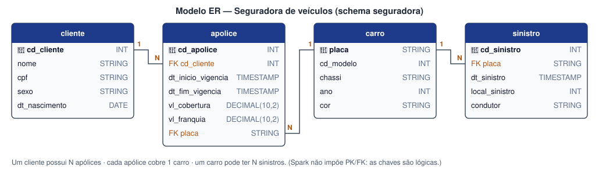
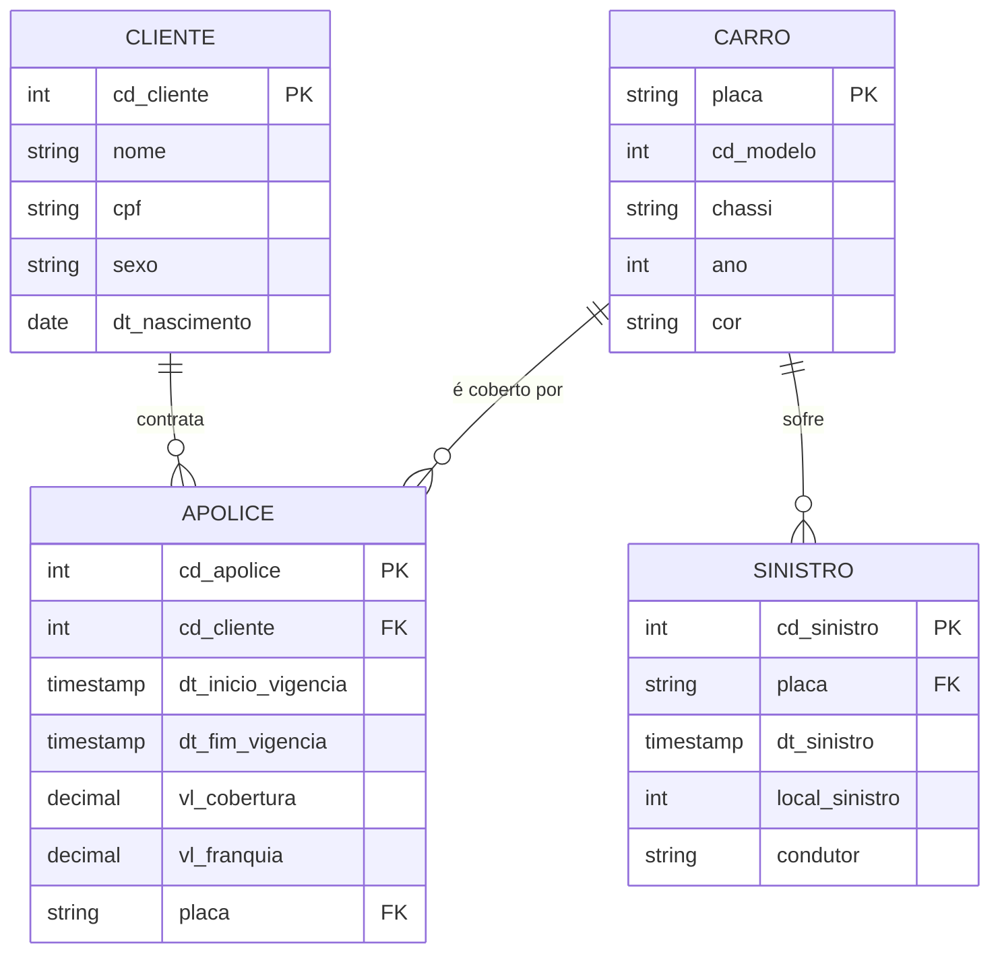

# Cenário e dados

## O negócio

Uma **seguradora de veículos** mantém clientes, carros, apólices (contratos de seguro) e sinistros
(acidentes, roubos...). Queremos guardar esses dados em um *lakehouse* e conseguir **inserir**,
**corrigir** e **apagar** registros com segurança, mantendo histórico das alterações.

## Modelo ER





| Tabela | Linhas | Descrição |
|---|---:|---|
| `cliente` | 20.010 | Pessoas que contratam seguros |
| `carro` | 10.001 | Veículos segurados |
| `apolice` | 10.000 | Contrato que liga **1 cliente** a **1 carro**, com vigência, cobertura e franquia |
| `sinistro` | 10.000 | Ocorrências envolvendo um carro (data, município IBGE, condutor) |

!!! note "Chaves no Spark"
    O Spark **não impõe** chaves primárias nem estrangeiras. As chaves do modelo são *lógicas*:
    servem para os JOINs e para as condições de `UPDATE`, `DELETE` e `MERGE`.

## Origem do dataset

Reaproveitamos o banco do **laboratório de Modelagem Dimensional** da disciplina
(`script_relacional.sql`, SQL Server, ~16 MB, com dados fictícios gerados para a aula). O script tem
milhares de comandos `INSERT [relacional].[tabela] (...) VALUES (...)` em T-SQL.

Como o Spark não executa T-SQL, criamos o script `scripts/converter_sql_para_csv.py`, que:

1. lê cada linha `INSERT` do arquivo;
2. separa os valores respeitando aspas e parênteses;
3. converte literais T-SQL — `N'texto'`, `CAST(N'2025-02-01T15:25:41.000' AS DateTime)`,
   `CAST(554382.00 AS Numeric(10, 2))`, `NULL` — em valores simples;
4. remove o preenchimento de colunas `CHAR` (`'HEG0631   '` → `HEG0631`);
5. grava `data/raw/<tabela>.csv`.

```bash
uv run task dados
```

```text
cliente     20010 linhas -> data/raw/cliente.csv
carro       10001 linhas -> data/raw/carro.csv
apolice     10000 linhas -> data/raw/apolice.csv
sinistro    10000 linhas -> data/raw/sinistro.csv
```

Na leitura, o Spark usa um **schema explícito** (em `src/spark_delta_iceberg/dados.py`) em vez de
inferir tipos — assim o CPF continua texto (não perde zeros à esquerda) e os valores ficam em
`DECIMAL(10,2)`.

## DDL das tabelas

O DDL é praticamente igual nos dois formatos. As diferenças estão destacadas abaixo.

=== "Delta Lake"

    ```sql
    CREATE DATABASE IF NOT EXISTS seguradora;

    CREATE TABLE IF NOT EXISTS seguradora.cliente (
        cd_cliente     INT     NOT NULL COMMENT 'PK - código do cliente',
        nome           STRING           COMMENT 'Nome completo',
        cpf            STRING  NOT NULL COMMENT 'CPF (texto para manter zeros à esquerda)',
        sexo           STRING           COMMENT 'M/F',
        dt_nascimento  DATE             COMMENT 'Data de nascimento'
    ) USING DELTA
    COMMENT 'Clientes da seguradora';

    CREATE TABLE IF NOT EXISTS seguradora.carro (
        placa      STRING NOT NULL COMMENT 'PK - placa do veículo',
        cd_modelo  INT             COMMENT 'Código do modelo',
        chassi     STRING NOT NULL COMMENT 'Número do chassi',
        ano        INT             COMMENT 'Ano de fabricação',
        cor        STRING          COMMENT 'Cor do veículo'
    ) USING DELTA
    COMMENT 'Veículos segurados';

    CREATE TABLE IF NOT EXISTS seguradora.apolice (
        cd_apolice          INT           NOT NULL COMMENT 'PK - número da apólice',
        cd_cliente          INT           NOT NULL COMMENT 'FK -> cliente',
        dt_inicio_vigencia  TIMESTAMP              COMMENT 'Início da vigência',
        dt_fim_vigencia     TIMESTAMP              COMMENT 'Fim da vigência',
        vl_cobertura        DECIMAL(10,2)          COMMENT 'Valor de cobertura (R$)',
        vl_franquia         DECIMAL(10,2)          COMMENT 'Valor da franquia (R$)',
        placa               STRING                 COMMENT 'FK -> carro'
    ) USING DELTA
    COMMENT 'Apólices: ligam 1 cliente a 1 carro';

    CREATE TABLE IF NOT EXISTS seguradora.sinistro (
        cd_sinistro     INT       NOT NULL COMMENT 'PK - código do sinistro',
        placa           STRING    NOT NULL COMMENT 'FK -> carro',
        dt_sinistro     TIMESTAMP          COMMENT 'Data/hora da ocorrência',
        local_sinistro  INT                COMMENT 'Código IBGE do município',
        condutor        STRING             COMMENT 'Nome do condutor'
    ) USING DELTA
    COMMENT 'Sinistros (ocorrências) por veículo';
    ```

=== "Apache Iceberg"

    ```sql
    CREATE NAMESPACE IF NOT EXISTS iceberg.seguradora;   -- (1)!

    CREATE TABLE IF NOT EXISTS iceberg.seguradora.cliente (
        cd_cliente     INT     NOT NULL COMMENT 'PK - código do cliente',
        nome           STRING           COMMENT 'Nome completo',
        cpf            STRING  NOT NULL COMMENT 'CPF (texto para manter zeros à esquerda)',
        sexo           STRING           COMMENT 'M/F',
        dt_nascimento  DATE             COMMENT 'Data de nascimento'
    ) USING iceberg
    COMMENT 'Clientes da seguradora';

    CREATE TABLE IF NOT EXISTS iceberg.seguradora.carro (
        placa      STRING NOT NULL COMMENT 'PK - placa do veículo',
        cd_modelo  INT             COMMENT 'Código do modelo',
        chassi     STRING NOT NULL COMMENT 'Número do chassi',
        ano        INT             COMMENT 'Ano de fabricação',
        cor        STRING          COMMENT 'Cor do veículo'
    ) USING iceberg
    COMMENT 'Veículos segurados';

    CREATE TABLE IF NOT EXISTS iceberg.seguradora.apolice (
        cd_apolice          INT           NOT NULL COMMENT 'PK - número da apólice',
        cd_cliente          INT           NOT NULL COMMENT 'FK -> cliente',
        dt_inicio_vigencia  TIMESTAMP              COMMENT 'Início da vigência',
        dt_fim_vigencia     TIMESTAMP              COMMENT 'Fim da vigência',
        vl_cobertura        DECIMAL(10,2)          COMMENT 'Valor de cobertura (R$)',
        vl_franquia         DECIMAL(10,2)          COMMENT 'Valor da franquia (R$)',
        placa               STRING                 COMMENT 'FK -> carro'
    ) USING iceberg
    COMMENT 'Apólices: ligam 1 cliente a 1 carro'
    TBLPROPERTIES (                                       -- (2)!
        'format-version'    = '2',
        'write.delete.mode' = 'merge-on-read',
        'write.update.mode' = 'merge-on-read',
        'write.merge.mode'  = 'merge-on-read'
    );

    CREATE TABLE IF NOT EXISTS iceberg.seguradora.sinistro (
        cd_sinistro     INT       NOT NULL COMMENT 'PK - código do sinistro',
        placa           STRING    NOT NULL COMMENT 'FK -> carro',
        dt_sinistro     TIMESTAMP          COMMENT 'Data/hora da ocorrência',
        local_sinistro  INT                COMMENT 'Código IBGE do município',
        condutor        STRING             COMMENT 'Nome do condutor'
    ) USING iceberg
    PARTITIONED BY (years(dt_sinistro))                   -- (3)!
    COMMENT 'Sinistros (ocorrências) por veículo';
    ```

    1. No Iceberg a tabela é referenciada como `catalogo.namespace.tabela`. O catálogo `iceberg` é
       configurado na `SparkSession`.
    2. **Merge-on-read**: UPDATE/DELETE gravam *delete files* em vez de reescrever os Parquet.
       Veja [Apache Iceberg](iceberg.md#copy-on-write-x-merge-on-read).
    3. **Hidden partitioning**: o Iceberg deriva o ano de `dt_sinistro` sozinho. Veja
       [Apache Iceberg](iceberg.md#hidden-partitioning).
