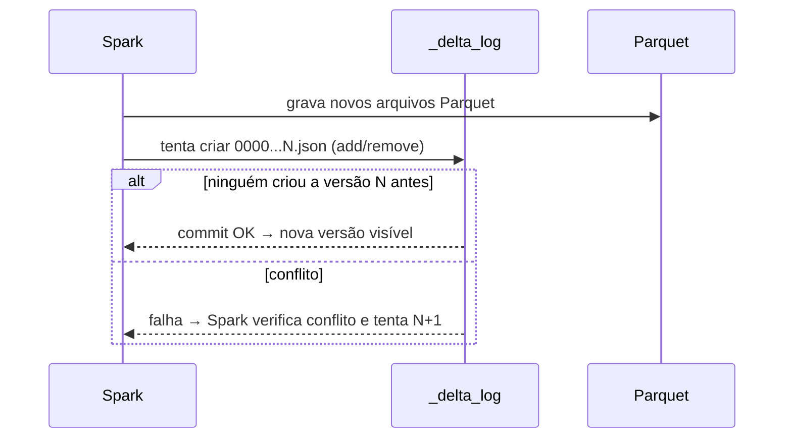

# Delta Lake

## O que é

O **Delta Lake** é um formato de tabela *open source* criado pela Databricks (hoje na Linux
Foundation). Uma tabela Delta é uma pasta com:

- arquivos **Parquet** com os dados;
- a pasta **`_delta_log/`** com o **log de transações**: um arquivo JSON por versão
  (`00000000000000000000.json`, `...001.json`...), mais *checkpoints* em Parquet a cada 10 versões.

```text
data/lakehouse/delta/seguradora.db/carro/
├── _delta_log/
│   ├── 00000000000000000000.json   ← CREATE TABLE
│   ├── 00000000000000000001.json   ← carga (WRITE)
│   ├── 00000000000000000002.json   ← INSERT
│   └── 00000000000000000003.json   ← UPDATE
├── part-00000-c862...c000.snappy.parquet
└── part-00000-78d4...c000.snappy.parquet
```

Cada commit lista **ações**: `add` (arquivo passa a fazer parte da tabela), `remove` (arquivo deixa
de fazer parte), `metaData`, `protocol` e `commitInfo`. O estado atual da tabela é o resultado de
"reproduzir" o log do início ao fim.



### Principais recursos

| Recurso | Como funciona |
|---|---|
| **ACID** | Um commit só existe quando o JSON da versão é criado de forma atômica. Leitores nunca veem escrita pela metade. |
| **UPDATE / DELETE / MERGE** | Os arquivos afetados são reescritos (*copy-on-write*) ou marcados com *deletion vectors*. |
| **Time travel** | `VERSION AS OF n` / `TIMESTAMP AS OF '...'` leem uma versão antiga. |
| **RESTORE** | Volta a tabela para uma versão anterior (gera um novo commit). |
| **Schema enforcement / evolution** | Rejeita dados fora do schema; aceita colunas novas com `mergeSchema`. |
| **VACUUM** | Apaga fisicamente arquivos não referenciados com mais de 7 dias (padrão). |

## Configuração no Spark

```python
from delta import configure_spark_with_delta_pip

builder = (
    SparkSession.builder.master("local[*]")
    .config("spark.sql.extensions", "io.delta.sql.DeltaSparkSessionExtension")
    .config("spark.sql.catalog.spark_catalog",
            "org.apache.spark.sql.delta.catalog.DeltaCatalog")
)
spark = configure_spark_with_delta_pip(builder).getOrCreate()
```

O pacote Python `delta-spark` traz a API (`DeltaTable`) e `configure_spark_with_delta_pip` adiciona
o JAR `io.delta:delta-spark_2.12:3.3.3` ao `spark.jars.packages` (baixado do Maven na 1ª execução).

## INSERT

```sql
INSERT INTO seguradora.cliente VALUES
    (20011, 'ANA PAULA SOUZA',     '12345678901', 'F', DATE'1995-04-12'),
    (20012, 'CARLOS EDUARDO LIMA', '10987654321', 'M', DATE'1988-11-30');

INSERT INTO seguradora.carro VALUES ('SAT2026', 10, '9BWZZZ377VT004251', 2024, 'PRATA');

INSERT INTO seguradora.apolice VALUES
    (10001, 20011, TIMESTAMP'2026-10-01 00:00:00', TIMESTAMP'2027-10-01 00:00:00',
     85000.00, 4500.00, 'SAT2026');
```

```text
+----------+-------------------+-----------+----+-------------+
|cd_cliente|nome               |cpf        |sexo|dt_nascimento|
+----------+-------------------+-----------+----+-------------+
|20012     |CARLOS EDUARDO LIMA|10987654321|M   |1988-11-30   |
|20011     |ANA PAULA SOUZA    |12345678901|F   |1995-04-12   |
+----------+-------------------+-----------+----+-------------+
```

Cada `INSERT` gera **uma nova versão** com uma ação `add` para o novo arquivo Parquet. A carga
inicial (≈50 mil linhas) usou a API de DataFrame, que também é um INSERT em lote:

```python
ler_csv(spark, "apolice").writeTo("seguradora.apolice").append()
```

## UPDATE

=== "SQL — uma linha"

    O caso do laboratório: o carro `CXK4218` foi pintado de preto.

    ```sql
    UPDATE seguradora.carro SET cor = 'PRETO' WHERE placa = 'CXK4218';
    ```

    ```text
    ANTES                       DEPOIS
    +-------+----+------+       +-------+----+-----+
    |  placa| ano|   cor|       |  placa| ano|  cor|
    +-------+----+------+       +-------+----+-----+
    |CXK4218|2008|CHUMBO|       |CXK4218|2008|PRETO|
    +-------+----+------+       +-------+----+-----+
    ```

=== "SQL — várias linhas"

    Reajuste de 10% nas apólices iniciadas em 2025:

    ```sql
    UPDATE seguradora.apolice
    SET vl_cobertura = CAST(vl_cobertura * 1.10 AS DECIMAL(10,2))
    WHERE YEAR(dt_inicio_vigencia) = 2025;
    ```

    ```text
    +-----------------+
    |num_affected_rows|
    +-----------------+
    |              982|
    +-----------------+
    total_cobertura: 550.415.493,00  →  605.457.042,30
    ```

=== "API Python (DeltaTable)"

    ```python
    from delta.tables import DeltaTable

    tb_cliente = DeltaTable.forName(spark, "seguradora.cliente")
    tb_cliente.update(
        condition="cd_cliente = 20012",
        set={"nome": "'CARLOS EDUARDO LIMA FILHO'"},
    )
    ```

**O que acontece por baixo:** o Delta localiza os arquivos que contêm linhas afetadas, reescreve
esses arquivos com os novos valores e registra no log um `remove` (arquivo antigo) e um `add`
(arquivo novo). O commit do UPDATE no carro ficou assim:

```text
commitInfo   UPDATE
add          part-00000-78d4e721-...-c000.snappy.parquet
remove       part-00000-c8622bf6-...-c000.snappy.parquet
```

!!! note
    O arquivo removido **continua no disco** — só deixa de fazer parte da versão atual. É isso que
    permite o *time travel*. Ele só é apagado de verdade pelo `VACUUM`.

## DELETE

=== "SQL — uma linha"

    ```sql
    DELETE FROM seguradora.sinistro WHERE cd_sinistro = 10001;
    ```

    ```text
    +-----------------+
    |num_affected_rows|
    +-----------------+
    |                1|
    +-----------------+
    ```

=== "SQL — várias linhas"

    Expurgo das apólices encerradas antes de julho/2023:

    ```sql
    DELETE FROM seguradora.apolice
    WHERE dt_fim_vigencia < TIMESTAMP'2023-07-01 00:00:00';
    ```

    ```text
    Total ANTES : 10001
    num_affected_rows: 201
    Total DEPOIS: 9800
    ```

=== "API Python (DeltaTable)"

    ```python
    tb_cliente.delete("cd_cliente = 20012")
    ```

## MERGE (upsert)

Atualiza quem existe e insere quem é novo em **um único commit** — o padrão de carga **SCD Tipo 1**
visto no laboratório de modelagem dimensional.

```sql
MERGE INTO seguradora.cliente AS destino
USING cliente_atualizacoes AS origem
ON destino.cd_cliente = origem.cd_cliente
WHEN MATCHED THEN UPDATE SET *
WHEN NOT MATCHED THEN INSERT *;
```

```text
+-----------------+----------------+----------------+-----------------+
|num_affected_rows|num_updated_rows|num_deleted_rows|num_inserted_rows|
+-----------------+----------------+----------------+-----------------+
|                2|               1|               0|                1|
+-----------------+----------------+----------------+-----------------+
```

## Histórico, time travel e RESTORE

```sql
DESCRIBE HISTORY seguradora.carro;
```

```text
+-------+-----------------------+------------+---------------+------------------+
|version|timestamp              |operation   |linhas_gravadas|linhas_atualizadas|
+-------+-----------------------+------------+---------------+------------------+
|3      |2026-10-05 21:14:37.362|UPDATE      |NULL           |1                 |
|2      |2026-10-05 21:14:31.042|WRITE       |1              |NULL              |
|1      |2026-10-05 21:14:23.708|WRITE       |10001          |NULL              |
|0      |2026-10-05 21:14:13.414|CREATE TABLE|NULL           |NULL              |
+-------+-----------------------+------------+---------------+------------------+
```

```sql
SELECT 'versão 1 (carga)' AS versao, placa, cor
FROM seguradora.carro VERSION AS OF 1 WHERE placa = 'CXK4218'
UNION ALL
SELECT 'versão atual', placa, cor FROM seguradora.carro WHERE placa = 'CXK4218';
```

```text
+----------------+-------+------+
|          versao|  placa|   cor|
+----------------+-------+------+
|versão 1 (carga)|CXK4218|CHUMBO|
|    versão atual|CXK4218| PRETO|
+----------------+-------+------+
```

`RESTORE` desfaz o expurgo de apólices voltando para a versão anterior ao DELETE:

```sql
RESTORE TABLE seguradora.apolice TO VERSION AS OF 3;  -- versão anterior ao DELETE
```

```text
Antes do RESTORE: 9800
Depois do RESTORE: 10001
```

!!! tip "Notebook completo"
    Todos os comandos e saídas estão no notebook
    [`notebooks/01_spark_delta_lake.ipynb`](https://github.com/MuriloMandelli/Projeto-Apache-Spark---Delta-Lake-e-Apache-Iceberg/blob/main/notebooks/01_spark_delta_lake.ipynb).
