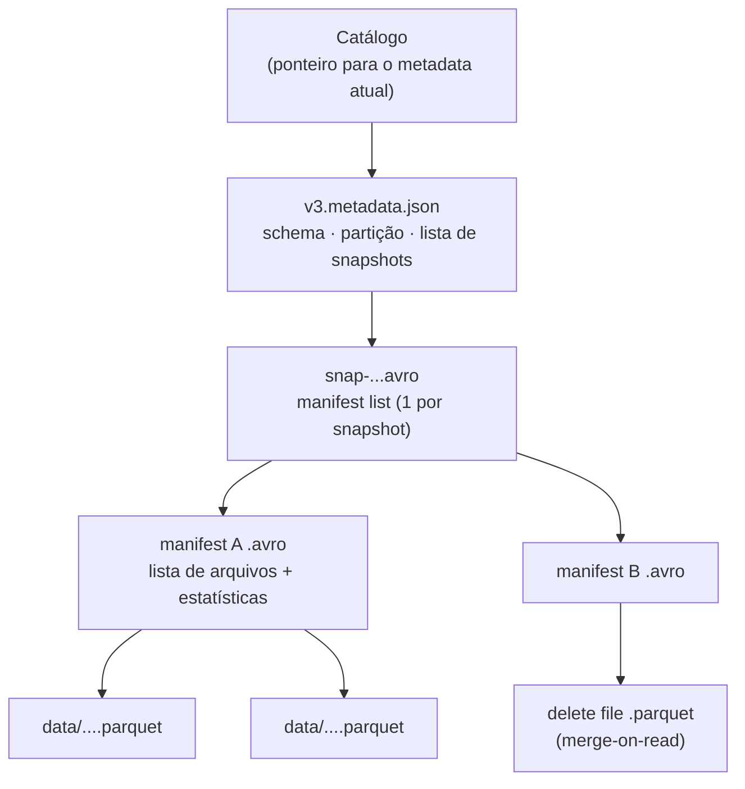

# Apache Iceberg

## O que é

O **Apache Iceberg** é um formato de tabela aberto, criado na Netflix e doado à Apache Software
Foundation. Foi pensado para tabelas **muito grandes** e para ser lido por **vários motores**
(Spark, Trino, Flink, Snowflake, DuckDB, Athena...).

A ideia central: a tabela é definida por uma **árvore de metadados**, não por uma pasta. Cada
alteração cria um novo **snapshot**, e trocar de snapshot é uma operação atômica (troca o ponteiro
para o arquivo de metadados atual).

## Arquitetura de metadados



| Camada | Conteúdo |
|---|---|
| **Catálogo** | Sabe qual é o `metadata.json` atual de cada tabela. Aqui usamos o catálogo `hadoop` (um arquivo `version-hint.text` na pasta). Em produção: REST, Hive, Glue, Nessie... |
| **metadata.json** | Schema, especificação de partição, propriedades e a lista de snapshots. |
| **Manifest list** | Um por snapshot: quais *manifests* compõem aquela versão. |
| **Manifests** | Listam os arquivos de dados/deletes com estatísticas (mín./máx. por coluna) — permitem pular arquivos sem abri-los. |
| **Arquivos de dados** | Parquet (padrão), ORC ou Avro. |

```text
data/lakehouse/iceberg/seguradora/sinistro/
├── data/
│   ├── dt_sinistro_year=2023/00000-...parquet
│   ├── dt_sinistro_year=2024/...
│   ├── dt_sinistro_year=2025/...
│   └── dt_sinistro_year=2026/...
└── metadata/
    ├── v1.metadata.json ... vN.metadata.json
    ├── snap-....avro          (manifest lists)
    ├── ....-m0.avro           (manifests)
    └── version-hint.text
```

## Recursos que se destacam

### Hidden partitioning

No Hive/Spark tradicional, para particionar por ano você cria uma coluna `ano` e todo mundo
precisa lembrar de filtrar por ela. No Iceberg a partição é uma **transformação** de uma coluna
existente:

```sql
PARTITIONED BY (years(dt_sinistro))   -- também: months, days, hours, bucket(N, col), truncate(L, col)
```

Quem consulta escreve só `WHERE dt_sinistro >= '2025-01-01'` e o Iceberg usa a partição
automaticamente. Resultado na tabela `sinistro`:

```text
+----+------------+----------+
| ano|record_count|file_count|
+----+------------+----------+
|2023|        2079|         1|
|2024|        2573|         1|
|2025|        2681|         1|
|2026|        2667|         1|
+----+------------+----------+
```

A partição também pode mudar com o tempo (**partition evolution**) sem regravar os dados antigos.

### Copy-on-write x merge-on-read

| Modo | UPDATE/DELETE | Leitura | Bom para |
|---|---|---|---|
| **copy-on-write** (padrão) | Reescreve os arquivos afetados | Rápida | Poucas alterações, muita leitura |
| **merge-on-read** | Grava só *delete files* + linhas novas | Junta deletes na hora de ler | Muitas alterações pequenas (CDC, *streaming*) |

Na `apolice` ativamos merge-on-read. Depois do UPDATE de 982 apólices, o arquivo original de 10.000
linhas **não foi reescrito**:

```text
+-------+-----------+------------+------------------+
|content|file_format|record_count|file_size_in_bytes|
+-------+-----------+------------+------------------+
|0      |PARQUET    |10000       |301136            |   ← dados originais (intactos)
|0      |PARQUET    |982         |31851             |   ← linhas com o novo valor
|0      |PARQUET    |1           |2306              |   ← apólice 10001 (INSERT)
|1      |PARQUET    |982         |2810              |   ← position delete file
+-------+-----------+------------+------------------+
```

`content = 0` são arquivos de dados; `content = 1` são *position deletes* (arquivo + posição da
linha apagada).

## Configuração no Spark

```python
spark = (
    SparkSession.builder.master("local[*]")
    .config("spark.jars.packages",
            "org.apache.iceberg:iceberg-spark-runtime-3.5_2.12:1.10.0")
    .config("spark.sql.extensions",
            "org.apache.iceberg.spark.extensions.IcebergSparkSessionExtensions")
    .config("spark.sql.catalog.iceberg", "org.apache.iceberg.spark.SparkCatalog")
    .config("spark.sql.catalog.iceberg.type", "hadoop")
    .config("spark.sql.catalog.iceberg.warehouse", "data/lakehouse/iceberg")
    .getOrCreate()
)
```

- `iceberg-spark-runtime-3.5_2.12` → runtime para **Spark 3.5** / **Scala 2.12**.
- `IcebergSparkSessionExtensions` → habilita `UPDATE`, `DELETE`, `MERGE` e `CALL` (procedures).
- `spark.sql.catalog.iceberg` → cria um catálogo chamado `iceberg`. As tabelas ficam em
  `iceberg.<namespace>.<tabela>`.

## INSERT

```sql
INSERT INTO iceberg.seguradora.cliente VALUES
    (20011, 'ANA PAULA SOUZA',     '12345678901', 'F', DATE'1995-04-12'),
    (20012, 'CARLOS EDUARDO LIMA', '10987654321', 'M', DATE'1988-11-30');

INSERT INTO iceberg.seguradora.sinistro VALUES
    (10001, 'SAT2026', TIMESTAMP'2026-10-03 14:30:00', 4204608, 'ANA PAULA');
```

Cada INSERT cria um snapshot com `operation = append`. No caso da `sinistro`, o Iceberg grava a
linha direto na partição `dt_sinistro_year=2026`.

## UPDATE

=== "Uma linha (copy-on-write)"

    ```sql
    UPDATE iceberg.seguradora.carro SET cor = 'PRETO' WHERE placa = 'CXK4218';
    ```

    ```text
    ANTES                       DEPOIS
    +-------+----+------+       +-------+----+-----+
    |CXK4218|2008|CHUMBO|       |CXK4218|2008|PRETO|
    +-------+----+------+       +-------+----+-----+
    ```

    Snapshot gerado: `operation = overwrite` (arquivo reescrito: 10.001 linhas removidas e
    10.001 adicionadas).

=== "Várias linhas (merge-on-read)"

    ```sql
    UPDATE iceberg.seguradora.apolice
    SET vl_cobertura = CAST(vl_cobertura * 1.10 AS DECIMAL(10,2))
    WHERE YEAR(dt_inicio_vigencia) = 2025;
    ```

    ```text
    982 apólices · total_cobertura: 550.415.493,00  →  605.457.042,30
    ```

    Gera 1 arquivo com 982 linhas novas + 1 *delete file* (veja a tabela acima).

## DELETE

```sql
-- um sinistro lançado por engano (mexe só na partição de 2026)
DELETE FROM iceberg.seguradora.sinistro WHERE cd_sinistro = 10001;

-- expurgo de apólices encerradas antes de julho/2023
DELETE FROM iceberg.seguradora.apolice
WHERE dt_fim_vigencia < TIMESTAMP'2023-07-01 00:00:00';
```

```text
Total ANTES : 10001
Total DEPOIS: 9800
```

!!! info "DELETE de partição inteira"
    Se a condição cobrir partições inteiras (ex.: `WHERE dt_sinistro < '2024-01-01'`), o Iceberg
    apenas remove os arquivos dos metadados, sem reescrever nada (*metadata-only delete*).

## MERGE (upsert)

```sql
MERGE INTO iceberg.seguradora.cliente AS destino
USING cliente_atualizacoes AS origem
ON destino.cd_cliente = origem.cd_cliente
WHEN MATCHED THEN UPDATE SET *
WHEN NOT MATCHED THEN INSERT *;
```

```text
+----------+-----------------------+-----------+----+-------------+
|cd_cliente|nome                   |cpf        |sexo|dt_nascimento|
+----------+-----------------------+-----------+----+-------------+
|20011     |ANA PAULA SOUZA MARTINS|12345678901|F   |1995-04-12   |   ← atualizado
|20013     |BRUNO HENRIQUE COSTA   |11122233344|M   |2001-02-20   |   ← inserido
+----------+-----------------------+-----------+----+-------------+
```

## Snapshots, time travel e rollback

As **tabelas de metadados** (`.snapshots`, `.history`, `.files`, `.partitions`, `.manifests`...) são
consultáveis com SQL:

```sql
SELECT committed_at, snapshot_id, parent_id, operation,
       summary['added-records'] AS linhas_add, summary['deleted-records'] AS linhas_del
FROM iceberg.seguradora.carro.snapshots ORDER BY committed_at;
```

```text
+-----------------------+-------------------+-------------------+---------+----------+----------+
|committed_at           |snapshot_id        |parent_id          |operation|linhas_add|linhas_del|
+-----------------------+-------------------+-------------------+---------+----------+----------+
|2026-10-05 21:15:33.211|4394266455667682387|NULL               |append   |10001     |NULL      |
|2026-10-05 21:15:36.385|2643032045395446224|4394266455667682387|append   |1         |NULL      |
|2026-10-05 21:15:38.396|8732939707927455274|2643032045395446224|overwrite|10001     |10001     |
+-----------------------+-------------------+-------------------+---------+----------+----------+
```

```sql
SELECT placa, cor FROM iceberg.seguradora.carro
VERSION AS OF 4394266455667682387         -- ou TIMESTAMP AS OF '2026-10-05 21:15:34'
WHERE placa = 'CXK4218';                  -- → CHUMBO (antes do UPDATE)
```

!!! note
    Os `snapshot_id` e horários mostrados aqui são de uma execução específica — eles mudam toda vez
    que o notebook roda. Por isso o notebook busca os IDs via SQL em vez de usá-los fixos.

O rollback é feito com uma *procedure*:

```sql
CALL iceberg.system.rollback_to_snapshot('seguradora.apolice', <snapshot_id>);
```

```text
Antes do rollback: 9800
Depois do rollback: 10001
```

!!! tip "Notebook completo"
    Todos os comandos e saídas estão no notebook
    [`notebooks/02_spark_apache_iceberg.ipynb`](https://github.com/MuriloMandelli/Projeto-Apache-Spark---Delta-Lake-e-Apache-Iceberg/blob/main/notebooks/02_spark_apache_iceberg.ipynb).
