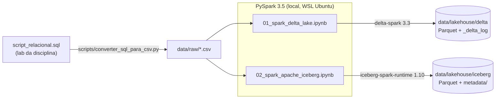

# Apache Spark com Delta Lake e Apache Iceberg

!!! info "Trabalho de Pesquisa — Engenharia de Dados"
    **Curso:** Engenharia de Software — SATC · **Professor:** Jorge Luiz da Silva
    **Equipe:** Murilo Mandelli e Augusto Benedetti

## Objetivo

Pesquisar e demonstrar, na prática, como o **Apache Spark** (via **PySpark**) trabalha com os dois
formatos de tabela mais usados em *data lakehouses*:

- :material-triangle-outline: **Delta Lake**
- :material-snowflake: **Apache Iceberg**

Para cada formato criamos tabelas, carregamos dados e executamos **INSERT**, **UPDATE** e **DELETE**
(além de MERGE e *time travel*), comparando como cada um resolve o mesmo problema.

## Por que isso importa?

Um *data lake* tradicional é só um monte de arquivos (CSV, Parquet...) em um disco ou bucket.
Ele é barato e escala muito, mas **não sabe** fazer o que um banco de dados faz:

| Problema no data lake "puro" | O que um formato de tabela resolve |
|---|---|
| Não existe `UPDATE`/`DELETE` — só dá para regravar arquivos inteiros | Comandos SQL de alteração de linhas |
| Dois processos escrevendo ao mesmo tempo corrompem os dados | Transações **ACID** |
| Não há histórico: sobrescreveu, perdeu | Versionamento e **time travel** |
| Schema muda e quebra quem lê | Controle e **evolução de schema** |

**Delta Lake** e **Apache Iceberg** adicionam uma camada de **metadados** sobre arquivos Parquet e
entregam essas garantias. Essa combinação "data lake + recursos de data warehouse" é chamada de
**Lakehouse**.

## Arquitetura do ambiente

Tudo roda **localmente** dentro do WSL (Ubuntu 24.04): não há cluster nem nuvem. O Spark roda em
modo `local[*]`, usando todos os núcleos da máquina.

| Componente | Versão |
|---|---|
| Ubuntu (WSL 2) | 24.04 |
| Java (OpenJDK) | 17 |
| Python | 3.12 |
| Gerenciador de projeto | uv |
| PySpark | 3.5.9 |
| delta-spark | 3.3.3 |
| iceberg-spark-runtime-3.5_2.12 | 1.10.0 |
| JupyterLab | 4.x |
| MkDocs Material | 9.x |

## Como navegar nesta documentação

1. **[Cenário e dados](cenario.md)** — o problema de negócio, o modelo ER, o dataset e o DDL.
2. **[Apache Spark (PySpark)](spark.md)** — o motor de processamento.
3. **[Delta Lake](delta.md)** — conceitos e os comandos com exemplos e resultados.
4. **[Apache Iceberg](iceberg.md)** — conceitos e os comandos com exemplos e resultados.
5. **[Delta x Iceberg](comparativo.md)** — diferenças lado a lado.

!!! tip "README x MkDocs"
    O **README** do repositório explica **como instalar e executar** o projeto.
    Esta documentação explica **o que** foi feito e **por quê** — os conceitos e os resultados.
