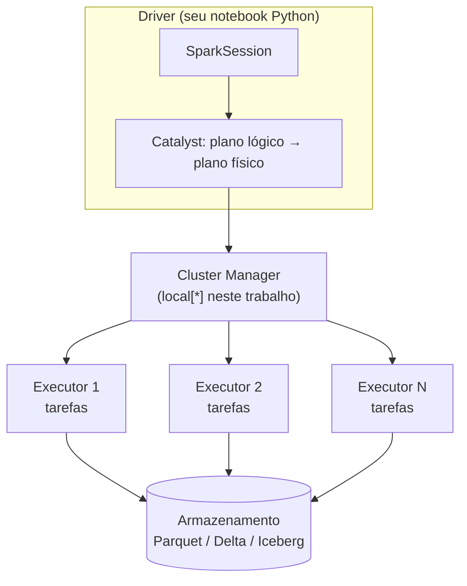

# Apache Spark (PySpark)

## O que é

O **Apache Spark** é um motor de processamento de dados **distribuído** e **em memória**. Ele
divide um grande volume de dados em pedaços (**partições**) e processa esses pedaços em paralelo,
em vários núcleos de uma máquina ou em várias máquinas de um cluster.

O **PySpark** é a API do Spark para **Python**. O motor em si roda na JVM (por isso precisamos do
Java 17); o PySpark conversa com ele através da biblioteca *Py4J*.

## Arquitetura



| Peça | Função |
|---|---|
| **Driver** | Programa principal: recebe seu código, monta o plano de execução e coordena tudo. |
| **SparkSession** | Porta de entrada da API. É nela que configuramos Delta/Iceberg. |
| **Catalyst** | Otimizador: transforma SQL/DataFrame em um plano físico eficiente. |
| **Executors** | Processos que executam as tarefas sobre as partições dos dados. |
| **Cluster manager** | Distribui recursos (YARN, Kubernetes, Standalone...). Aqui usamos `local[*]`: driver e executores na mesma máquina, um *thread* por núcleo. |

## Conceitos essenciais

**DataFrame** — tabela distribuída com colunas tipadas. Pode ser manipulada com métodos Python
ou com SQL; ambos geram o mesmo plano.

=== "API DataFrame"

    ```python
    from pyspark.sql import functions as F

    (spark.table("seguradora.sinistro")
         .groupBy(F.year("dt_sinistro").alias("ano"))
         .count()
         .orderBy("ano")
         .show())
    ```

=== "Spark SQL"

    ```python
    spark.sql("""
        SELECT YEAR(dt_sinistro) AS ano, COUNT(*) AS count
        FROM seguradora.sinistro
        GROUP BY 1 ORDER BY 1
    """).show()
    ```

**Avaliação preguiçosa (*lazy evaluation*)** — transformações (`select`, `filter`, `join`...) só
montam o plano. Nada é executado até uma **ação** (`show`, `count`, `write`...). Isso permite ao
Catalyst otimizar o plano inteiro de uma vez.

**Catálogo** — onde o Spark registra bancos (*namespaces*) e tabelas. O Delta substitui o catálogo
padrão (`spark_catalog`); o Iceberg adiciona um catálogo novo (aqui chamado `iceberg`).

**Formatos de arquivo x formatos de tabela** — **Parquet** é um formato de *arquivo* colunar
(compacto e rápido para leitura). **Delta** e **Iceberg** são formatos de *tabela*: usam Parquet
para os dados e acrescentam metadados para ter transações, versões e `UPDATE`/`DELETE`.

## Como o projeto cria a SparkSession

As duas sessões estão em `src/spark_delta_iceberg/spark_session.py` e compartilham uma base:

```python
SparkSession.builder.appName(nome_app)
    .master("local[*]")                          # todos os núcleos da máquina
    .config("spark.driver.memory", "2g")
    .config("spark.sql.shuffle.partitions", "4") # padrão é 200: exagero para dados pequenos
    .config("spark.ui.showConsoleProgress", "false")
    .config("spark.sql.session.timeZone", "America/Sao_Paulo")
```

=== "Sessão Delta"

    ```python
    from delta import configure_spark_with_delta_pip

    builder = (
        base
        .config("spark.sql.extensions", "io.delta.sql.DeltaSparkSessionExtension")
        .config("spark.sql.catalog.spark_catalog",
                "org.apache.spark.sql.delta.catalog.DeltaCatalog")
        .config("spark.sql.warehouse.dir", "data/lakehouse/delta")
    )
    spark = configure_spark_with_delta_pip(builder).getOrCreate()
    ```

=== "Sessão Iceberg"

    ```python
    spark = (
        base
        .config("spark.jars.packages",
                "org.apache.iceberg:iceberg-spark-runtime-3.5_2.12:1.10.0")
        .config("spark.sql.extensions",
                "org.apache.iceberg.spark.extensions.IcebergSparkSessionExtensions")
        .config("spark.sql.catalog.iceberg", "org.apache.iceberg.spark.SparkCatalog")
        .config("spark.sql.catalog.iceberg.type", "hadoop")
        .config("spark.sql.catalog.iceberg.warehouse", "data/lakehouse/iceberg")
        .getOrCreate()
    )
    ```

!!! warning "Compatibilidade de versões"
    Os JARs precisam casar com o Spark: `delta-spark 3.3.x` e `iceberg-spark-runtime-3.5_2.12`
    são feitos para **Spark 3.5** compilado com **Scala 2.12** (o PySpark 3.5 do PyPI). Misturar
    versões causa erros como `ClassNotFoundException` ou `NoSuchMethodError`.

## Lendo os dados de entrada

```python
from spark_delta_iceberg.dados import SCHEMAS

df = (spark.read
      .option("header", True)
      .option("timestampFormat", "yyyy-MM-dd HH:mm:ss")
      .schema(SCHEMAS["apolice"])        # schema explícito, sem inferência
      .csv("data/raw/apolice.csv"))

df.writeTo("seguradora.apolice").append()            # Delta
df.writeTo("iceberg.seguradora.apolice").append()    # Iceberg
```

`writeTo(...).append()` é a API **DataFrameWriterV2**: funciona igual para Delta e Iceberg e
equivale a um `INSERT INTO ... SELECT` em lote.
